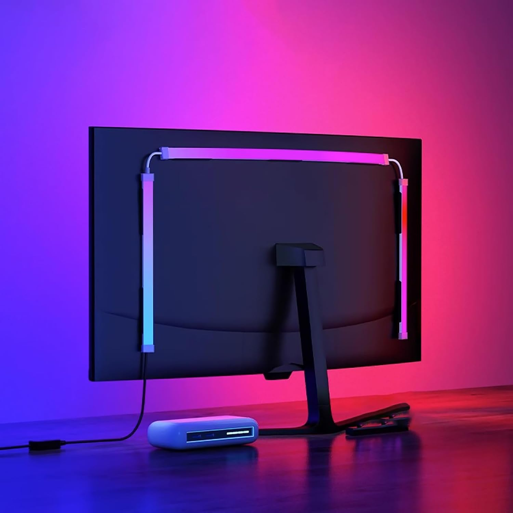

# Rainbow Music Led (WLED)

Direct SignalRGB support for a WLED strip, with no vendor app running. Colours go
out over WLED's realtime UDP channel, with an HTTP `/json/state` fallback when
UDP is unavailable.

## Requirements

- WLED on ESP8266/ESP32 (tested on WLED `0.13.0-b3`).
- SignalRGB `2.5.86` (tested), with the strip reachable over the LAN.
- No vendor app is required; close it if it is streaming to the same strip.

## Installation

1. Click the button above, or open SignalRGB → **Settings → Add-ons → Add Add-on**
   and paste `https://github.com/peterng1618/signalrgb-rainbow-music-led`.
2. Restart SignalRGB when prompted.
3. Open the device's **Discover strip** panel. Enter your strip IP and press
   **Add strip**. To scan, enter your LAN prefix (first three octets, e.g.
   `192.168.2`) and press **Scan LAN**. Each strip appears as its own SignalRGB
   device, identified by its WLED MAC address — a DHCP/IP change updates the
   same device instead of creating a duplicate. Geometry and LED count can be
   overridden per device.

## Settings

| Setting | Meaning | Default |
| --- | --- | --- |
| Strip IP | Address of the WLED device. Blank = no traffic unless discovered. | (blank) |
| UDP port | Realtime port; `0` reads `if.sync.port0` from `/json/cfg`. | `0` |
| HTTP port | Port used by the fallback transport. | `80` |
| Transport | `Auto`, `UDP` or `HTTP`. | `Auto` |
| Max refresh rate | Frames per second cap. | `40` |
| WLED master brightness | Master brightness written before streaming. | `255` |
| LED count | Number of LEDs on the strip. | `118` |
| Physical layout | `Ring` (closed 4-bar rectangle), `U` (3-bar, hollow bottom), or `Strip`. | `Ring` |
| Ring outer width / strip LEDs per row | Layout width. | `45` |
| Ring outer height / strip rows | Layout height. | `16` |
| Serpentine rows | Strip only: zig-zag rows. | `false` |
| First LED corner | Strip mode only: where LED index 0 sits. Ring/U LED 0 is fixed on the strip's first LED. | `Bottom-Left` |
| Direction from first LED | `Clockwise` (LED 1 up the left side from bottom-left) or `Counter-Clockwise`. | `Clockwise` |
| Lighting Mode | `Canvas` follows the effect, `Forced` uses one colour. | `Canvas` |
| Forced Color | Colour used in `Forced` mode. | `#009bde` |
| Shutdown Color | Written when SignalRGB shuts down. | `#000000` |

## Troubleshooting

- **Device appears but stays dark.** Use the Discover strip panel to add the
  strip by IP, or enter your LAN prefix and start a LAN scan (8 addresses per
  discovery tick; a full /24 takes several minutes).
- **DHCP moved the strip.** Discovery matches by WLED MAC, so the same device
  updates to the new IP. No manual cleanup needed.
- **Streams, but goes back to a saved preset after quitting SignalRGB.** WLED
  restores its previous state when realtime frames stop. The plugin sets the
  running segment to solid black before streaming, so the revert lands on black.
  If it still shows a preset, clear the segment's saved state in WLED.
- **UDP does not enter realtime mode.** Some WLED builds use a non-default
  realtime port. Check `if.sync.port0` in `/json/cfg`, or set the UDP port
  manually; the plugin falls back to HTTP automatically after repeated failures.

## Support

Open an issue on this repository.

## License

MIT — see `LICENSE`.
